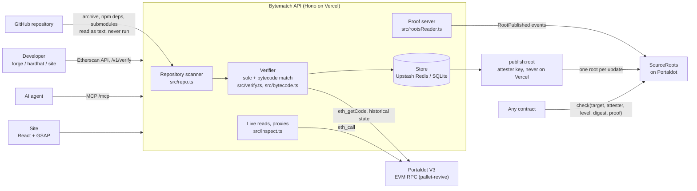

# Bytematch

**Every contract claims a source. Bytematch checks it.**

[](https://bytematch-portaldot.vercel.app/address/0x0f9691a6aae5d9b5ed7190551049ced18b8ed086)
[](https://bytematch-portaldot.vercel.app/address/0x6aea3b20e67e8b5b660d0d8eb917c790e190a203)

[](https://bytematch-portaldot.vercel.app)

There are 242 contracts on the Portaldot V3 testnet. When this project started, the
source of exactly **none** of them could be checked: no Etherscan, no Sourcify, and the
official explorers only index the Substrate side. Every "deployed at `0x…`" in every
README was taken on faith.

Today **118** of them can be checked, byte for byte, and the results are on chain.

**[bytematch-portaldot.vercel.app](https://bytematch-portaldot.vercel.app)**

## Try it in ten seconds

Paste an address or a GitHub repository into the box on the site. Or:

```sh
# a whole repository: finds what it deployed, verifies all of it
curl -X POST https://bytematch-portaldot.vercel.app/v1/repos -d '{"url": "https://github.com/Junedkhan121/portalswap"}'

# one contract
curl https://bytematch-portaldot.vercel.app/v1/contracts/0x5432e6b89dc3042d47f2be98e971cad9dabab685

# your agent
claude mcp add --transport http bytematch https://bytematch-portaldot.vercel.app/mcp
```

Already deployed with Foundry or Hardhat? `forge verify-contract` and `hardhat verify`
work against Bytematch unchanged ([setup](#foundry)).

## We pointed it at the whole hackathon

Every Portaldot Hacker House 2026 submission with a GitHub repository, 74 of them, went
through `POST /v1/repos` with nothing but its URL. No settings, no contract names, no
help from the teams.

| | |
|---|---|
| Repositories read | **74** |
| …that point at contracts deployed on V3 | **56** |
| …with at least one contract matched to source | **47** |
| …where *every* deployed contract matched | **38** |
| Exact matches (every byte, metadata included) | **49** |
| Partial matches (same code, different metadata) | **53** |
| Deployed contracts that don't match the repository | **34** |

The 34 are the interesting ones. Some are tokens a project uses but didn't write. Others
are contracts the repository moved past after deploying: DotProof's `LendingMarket`
was deployed before later fixes, and its own `SECURITY.md` says so. The README and the
chain both looked fine. Only one of them describes the code that holds the funds.

`GET /v1/repos` and `GET /v1/network` have the live figures.

## What it does

- **Exact or partial, never "trust me".** Compiles with the official solc builds and
  compares against `eth_getCode`. **Exact** means every byte matches, metadata included,
  so the source text itself is proven. **Partial** means the same executable code with
  different comments, paths or metadata settings.
- **A whole repository from one URL.** Reads the repo without running any of its code,
  finds its Foundry and Hardhat projects and their settings, collects every address it
  mentions that has code on chain, and verifies each one. npm dependencies at the
  lockfile versions, git submodules at their pinned commits, Foundry remappings honoured.
- **Finds the deploy transaction by itself.** Portaldot has no contract-creation lookup
  and the indexers start partway through the chain, so Bytematch searches historical
  `eth_getCode` (8 probes a round, ~3s for 250k blocks) and recovers constructor
  arguments from the creation input.
- **Works from a single `.sol` file.** Reads the compiler version and metadata mode from
  the deployed bytes and searches the settings people actually deploy with. Sources that
  can't match are rejected in about a second by checking function selectors.
- **Records on chain for ~0.01 POT a contract.** One storage slot per contract would cost
  ~9 POT; the hackathon allowance is 500. [SourceRoots](#sourceroots-on-chain-records-at-about-001-pot-a-contract)
  keeps every result under one Merkle root, rebuildable from the chain alone, and any
  contract can gate on it with a proof.
- **Reads what it verifies.** Every public value live, any view function, and proxies
  (EIP-1967, beacon, EIP-1167 clones) read through their implementation's verified ABI.
- **Built for agents too.** An MCP endpoint with five tools, and `/llms.txt` describing the
  whole service in one page.
- **Badges.** `/badge/<address>.svg` shows the live state, like the ones at the top of
  this page.
- **Speaks Etherscan.** `forge verify-contract` and `hardhat verify` work without a plugin.

## Architecture



The deployment never holds a key: it reads the chain and serves results and proofs.
Roots are published from wherever the attester key lives.

<details>
<summary>Hand-picked checks from before the repository scanner, with each project's recorded settings</summary>

| Project | Contract | Address | Result |
|---|---|---|---|
| Plaque | PlaqueLite | `0x5432e6b89dc3042d47f2be98e971cad9dabab685` | exact (with its original source path), deploy input matched |
| Vestry | Vestry | `0x12d0691c7b756aa5205f24b678d68c74b885cda9` | exact |
| Vestry | Guestbook | `0xc3ee4b657fadae473b22c692544e35223bfe9b42` | exact |
| DotProof | Gateway | `0x619ca0f74bbe92cae32ca72920cba0ff0e5af370` | exact, 4 source files incl. OpenZeppelin |
| DotProof | BPOT | `0xf8191413d53b750ce2f0bfc44722c0ebf0bf95a1` | exact; created by another contract, so no deploy tx |
| DotProof | Backstop | `0xb57969ce443dbdf2f41e67408a77e5311b548187` | exact, constructor args recovered |
| DotProof | AgentRegistry | `0x95cced224908a20d7b4a7d684cbc9acd4b0e2177` | exact, 8 constructor args recovered |
| Allowance | Allowance | `0xdf8567f1fa9f6afbe1c8f99453544c35009ac07f` | partial: same code, metadata differs from the current repo |
| PortalSwap | PortalSwapFactory | `0xc631805c297c4233b33c30af91245058902c1d18` | exact |
| PortalSwap | PortalSwapRouter | `0xc17510df29ae5e4c6c2a46ccb03197edd0963f2b` | exact; constructor args are the factory and WPOT above/below |
| PortalSwap | WPOT | `0xf67ce92096e4e171060b71bf0cca0da9f9548c03` | exact |
| PortalSwap | MockERC20 (pUSDT and three other test tokens) | `0xe0114adc0a2072b602c645f5a07eefa1eadbdbc2` and 3 more | exact, name/symbol/decimals/supply decoded |
| PortalSwap | tPotFaucet, tPotStaking | `0x2a9dfcc2…`, `0xc3a38deb…` | exact |
| PortalSwap | PortalSwapPair | `0x521d8aafeee92e2fa31829faa009fe3698245b93` | exact; the other 9 pools share its code and show as same-code |
| DotProof | BackingMonitor, CircuitBreaker, LendingMarket | | **no match** with current source |

For PortalSwap no contract names were given: Bytematch compiled the whole project and
picked the matching contract for each address.

The DotProof "no match" row is the tool working as intended. DotProof's own `SECURITY.md` says those
contracts were deployed before later fixes and are immutable, so the repository no
longer describes the code on chain.


</details>

## How matching works

A plain string compare of compiled and deployed bytecode fails in four common cases,
each handled in [`src/bytecode.ts`](src/bytecode.ts):

1. **Metadata.** solc appends a CBOR blob with an IPFS hash of the metadata JSON, which
   covers source text, file paths and settings. If everything including that blob
   matches, it's exact. If only the blob differs (every one in the code, including
   those of child contracts created with `new`), it's partial.
2. **Immutables** are written into runtime code by the constructor. The deployed bytes
   at the compiler's `immutableReferences` are copied in and reported.
3. **Linked libraries** are filled in from the deployed code at `linkReferences` and
   reported.
4. **Libraries themselves** start with `PUSH20 <own address>`, set at deploy time.

Source keys matter for exact matches because they are hashed into the metadata.
[`src/collect.ts`](src/collect.ts) gathers a contract's imports using the same keys
Hardhat and Foundry use, without running any project code.

## API

```
POST /v1/verify
  { "address": "0x…",
    "standardJsonInput": { "language": "Solidity", "sources": {…}, "settings": {…} },
    "contract": "contracts/Vault.sol:Vault",      // optional
    "compilerVersion": "0.8.28" }                 // optional, read from bytecode
  or { "address": "0x…", "files": { "Vault.sol": "…" } }                    // settings searched
  or { "address": "0x…", "metadata": "<metadata.json>", "files": { … } }   // Remix / Hardhat

GET /v1/contracts/:address          status (verified | same-code | unverified), record, ABI, on-chain attestation
GET /v1/contracts/:address/abi
GET /v1/contracts/:address/files
GET /v1/contracts/:address/bundle   everything needed to reproduce the verification
GET /v1/contracts/:address/state    every public value, read live (?abi=<implementation> for proxies)
POST /v1/contracts/:address/call    { "function": "balanceOf", "args": ["0x…"] }
POST /v1/repos                      { "url": "https://github.com/owner/repo" }: verify a whole repository
GET /v1/repos                       every repository checked
GET /v1/repos/:owner/:repo          its report
GET /badge/:address.svg             README badge
POST /mcp                           Model Context Protocol (streamable HTTP)
GET /llms.txt
GET /v1/contracts                   recently verified
GET /v1/network                     every contract on the chain with its status (?status=unverified etc.)
GET /v1/stats
GET /health
```

`same-code` means the address isn't verified itself, but its runtime code is identical
to a contract that is.

Errors come back as `{ "error": { "code", "message", "details" } }` with codes
`bad_input`, `not_contract`, `polkavm`, `compile_error`, `version_mismatch`, `no_match`.

Checked end to end with `@nomicfoundation/hardhat-verify` 2.x and with Foundry 1.5
(`forge verify-contract --verifier custom`): submit, poll, "successfully verified", exact
match. Foundry 1.x refuses `--verifier etherscan` for chains it doesn't know; use
`custom`.

### Foundry

```sh
forge verify-contract <address> src/Vault.sol:Vault \
  --chain 420420777 \
  --verifier custom \
  --verifier-url https://bytematch-portaldot.vercel.app/api \
  --verifier-api-key unused \
  --watch
```

### Hardhat (`@nomicfoundation/hardhat-verify`)

```js
etherscan: {
  apiKey: { portaldot: 'unused' },
  customChains: [{
    network: 'portaldot',
    chainId: 420420777,
    urls: { apiURL: 'https://bytematch-portaldot.vercel.app/api', browserURL: 'https://bytematch-portaldot.vercel.app' },
  }],
},
```

then `npx hardhat verify --network portaldot <address> [constructor args]`.

## The bundle and the digest

Every verification produces a bundle: compiler version, contract name and the standard
JSON input (minus `outputSelection`, which never changes bytecode). Its digest is the
keccak256 of the bundle serialised with sorted keys, and that digest is what
`SourceRegistry` stores. Anyone can download the bundle, recompile it with stock solc,
and compare against any contract with the attested code hash. The service doesn't need
to be trusted or even online for that check.

## SourceRegistry

[`contracts/SourceRegistry.sol`](contracts/SourceRegistry.sol)

```solidity
function attest(address sample, bytes32 sourceDigest, Match level) external returns (bytes32 codeHash);
function revoke(bytes32 codeHash) external;
function check(address target, address attester) external view returns (Match level, bytes32 sourceDigest);
```

- Keyed by code hash, so one verification covers every deployment of the same code, and
  an attestation never applies to code it wasn't made for.
- The code hash is read from `sample` inside `attest`, so an attester can't vouch for a
  hash that doesn't exist on chain.
- Anyone can attest. Readers decide whose attestations they trust.

On Portaldot, `EXTCODEHASH` returns keccak256 of the deployed EVM code (checked against
the live chain), so `check` sees the same hash the off-chain verifier computes.

## SourceRoots: on-chain records at about 0.01 POT a contract

A new storage slot on Portaldot costs a deposit of about 4.5 POT, so one SourceRegistry
attestation (two slots) costs about 9 POT, and a hackathon allowance of 500 tPOT covers
about 54 contracts.

[`SourceRoots`](contracts/SourceRoots.sol) (`0x0f9691a6aae5d9b5ed7190551049ced18b8ed086`)
keeps one Merkle root per attester over all its results, keyed by code hash, plus the
root before it so proofs fetched just before an update stay valid. Each update
overwrites those two slots. The entries (65 bytes per program) travel in the
`RootPublished` event; each event carries only the entries new since the last root, and
the tree is the union of the attester's events. Anyone can rebuild the tree and every
proof from the chain alone; the API does exactly that
([`src/rootsReader.ts`](src/rootsReader.ts)) and never serves a proof for a tree that
doesn't hash to the on-chain root.

Measured on the V3 testnet:

| | POT |
|---|---|
| Deploy (mostly the code deposit) | ~100 |
| First root (deposit for the current-root slot), 89 programs | 4.51 |
| Second root (deposit for the previous-root slot), 99 programs | 4.58 |
| Every update after that | ~0.04 + ~0.008 per new program |

Contracts gate on it with `check(target, attester, level, sourceDigest, proof)`, which
returns the level or 0; `GET /v1/contracts/:address` returns `onChain.proof`.

```sh
npm run deploy:roots -- --send                                         # once
npm run publish:root -- https://bytematch-portaldot.vercel.app --send   # after new verifications
```

## The site

[`web/`](web) is the frontend: a Vite + React app. The home page has one field, for an
address or a repository, and tells the story in four scroll-driven chapters (GSAP,
Lenis): a 1950 punched card, PlaqueLite's real bytes compared one by one, the Hacker
House repositories checked so far, and every contract on the chain as a punch card.
Pages: `/address/:address` (where Hardhat's `browserURL` points; source, live reads,
proxy target, badge), `/repo/:owner/:repo`, `/repos`, `/verify` and `/network`.
- Photograph: keypunch operator, 1950 US Census. U.S. Census Bureau, public domain.

```sh
npm start              # API on :8787
npm run dev:web        # site on :5173, proxying the API
```

## Deploy for free (Vercel + Upstash)

Everything runs on Vercel's free plan: the site is static and the API is one function
(`api/index.ts`). Results are stored in Upstash Redis, which also has a free plan.

1. On vercel.com, **Add New → Project** and import this repository. Leave the build
   settings alone; `vercel.json` sets them.
2. In the project, **Storage → Create → Upstash for Redis** (free) and connect it. This
   adds `KV_REST_API_URL` and `KV_REST_API_TOKEN`.
3. Add `REGISTRY_ADDRESS` to show on-chain status read-only; add `ATTESTER_KEY` (a funded testnet key) too to attest new results. Both go under
   **Settings → Environment Variables** so new results are attested on chain.
4. Redeploy, then copy existing verifications across:
   `npm run seed:remote -- https://<your-project>.vercel.app`

New results on a deployment without `ATTESTER_KEY` are stored but not attested. To
record them, run from a machine that holds the key (dry run first, then `--send`):
`npm run attest:remote -- https://<your-project>.vercel.app`

Verification compiles on the function, so the first request on a cold instance
downloads the solc build it needs (~8 MB) into `/tmp`.

## Running it

Node 22.13 or later.

```sh
npm install
npm test                 # unit tests, offline (bytecode matching, registry in a local EVM)
npm run test:live        # against the V3 testnet
npm start                # API on :8787
```

Environment (all optional):

| Variable | Default |
|---|---|
| `RPC_URL` | `https://test-evm-rpc-v3.portaldot.dev` |
| `CHAIN_ID` | `420420777` |
| `PORT` | `8787` |
| `DATA_DIR` | `./data` (SQLite database and cached solc builds) |
| `REGISTRY_ADDRESS`, `ATTESTER_KEY` | unset: results are stored but not attested on chain |

Deploy the registry with a funded testnet key: `ATTESTER_KEY=0x… npm run deploy:registry`.
It builds, deploys, verifies itself and writes `deployments/portaldot-testnet.json`.

## Limits

- EVM bytecode only. PolkaVM contracts (built with `resolc`) are detected and reported,
  not verified. On V3 today that's 5 contracts in 241.
- Solidity only, no Vyper.
- Contracts created by other contracts or by native extrinsics are verified on runtime
  code; constructor arguments are then unknown.
- Settings search covers common settings (optimizer off/on with 1, 200, 1k, 10k and
  999,999 runs; viaIR on/off; the usual EVM versions). Anything else needs the standard
  JSON input.
- Compilation runs on the API process. Fine for a testnet; a busy deployment should
  move it to worker threads.
- Repository checks run inside one Vercel function call, so they stop at 5 minutes;
  one Hacker House repository in 74 is larger than that. Repositories are read from
  GitHub's public archive, so private repositories need `GITHUB_TOKEN`.
- Rate limits (3 repository checks and 10 verifications a minute per client) are kept in
  memory per function instance, so they are approximate.
- The public Portaldot RPC answers 503 under load. Every call retries with backoff,
  but a long outage shows up as an error.
- SourceRoots is updated by running `publish:root` where the attester key is. A
  verification made after the latest root shows as verified on the site but not yet on
  chain until the next publish. SourceRegistry (one slot per program) is the first
  version and still answers `check` for the 17 programs attested there.

## Team

- Miracle ([@miracle352](https://github.com/miracle352)): design, build, deployment

## Built with

Written during the Portaldot Hacker House (Oct–Nov 2026). Third-party pieces it stands on:

- [solc](https://github.com/ethereum/solc-js) (official Solidity compiler builds), [ethers](https://github.com/ethers-io/ethers.js), [Hono](https://github.com/honojs/hono), [zod](https://github.com/colinhacks/zod)
- [Upstash Redis](https://upstash.com) and Node's built-in SQLite for storage; [Vercel](https://vercel.com) for hosting
- [React](https://react.dev), [Vite](https://vitejs.dev), [GSAP](https://gsap.com), [Lenis](https://github.com/darkroomengineering/lenis); fonts Schibsted Grotesk and Martian Mono via [Fontsource](https://fontsource.org)
- [Vitest](https://vitest.dev) and [@ethereumjs/vm](https://github.com/ethereumjs/ethereumjs-monorepo) for tests; [Foundry](https://getfoundry.sh) and [hardhat-verify](https://github.com/NomicFoundation/hardhat) for end-to-end checks
- Photograph: keypunch operator, 1950 US Census, U.S. Census Bureau, public domain

## License

MIT

## Deployment (Portaldot V3 testnet)

EVM chain ID 420420777, RPC `https://test-evm-rpc-v3.portaldot.dev`. Portaldot has no EVM
block explorer, so each contract's Bytematch page is linked as its explorer page.

| | Address or transaction | Block |
|---|---|---|
| **SourceRoots** (current on-chain record) | [`0x0f9691a6aae5d9b5ed7190551049ced18b8ed086`](https://bytematch-portaldot.vercel.app/address/0x0f9691a6aae5d9b5ed7190551049ced18b8ed086), verified exact through `forge verify-contract` | 306369 |
| SourceRoots deploy | `0xb9fffafd15f0171c8f4aee75ca2545bad51c2d45e73a300a650f025800a8515e` | 306369 |
| Root 2, 99 programs (current) | `0x2356eef3e58565e536bc6d1369cfc37132830319e81c4ed0c1953385e5609714` | 306689 |
| Root 1, 89 programs | `0x0a581a6e11fe3a72f59cea49e9618d9d8679922154c734a67c585c72f283f275` | 306374 |
| SourceRegistry (first version, one slot per program) | [`0x6aea3b20e67e8b5b660d0d8eb917c790e190a203`](https://bytematch-portaldot.vercel.app/address/0x6aea3b20e67e8b5b660d0d8eb917c790e190a203), verified exact | 244720 |
| SourceRegistry deploy | `0x079662fa74d68780d31bf9b21980cfda10da1e58d9004b3c83a8b1567436bb3d` | 244720 |
| SourceRegistry attestations (17) | `0xb0037034dc21658f01c16fbcb8d459baabced4e6766fc41d1701ae7700ad3426` … `0xcab5cfe37b867b13602768d310f3128879f7f0fc9b291c07e040a613279210b4` | 244727–244746 |
| Attester | `0x8d375990766be8a0d1e1a93e6f9fa33ac2023ff3` (Substrate `5FFs3veWqFTWM2h2aya9mKi7HhBKz6Hdk8LsPnUnV6M61dCA`) | |

Details in [`deployments/portaldot-testnet.json`](deployments/portaldot-testnet.json).
